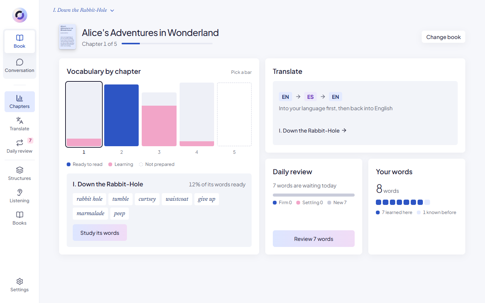

<p align="center">
  <picture>
    <source media="(prefers-color-scheme: dark)" srcset="assets/es/hero-dark.svg">
    
  </picture>
</p>

<p align="center">
  <a href="https://github.com/ilien-dev/ogmios/releases/latest"></a>
  <a href="https://github.com/ilien-dev/ogmios/releases/latest"></a>
  <a href="https://github.com/ilien-dev/ogmios/actions/workflows/ci.yml"></a>
  <a href="LICENSE"></a>
  <a href="https://ogmios.ilien.dev/es/"></a>
</p>

# Ogmios: practica inglés hablado con IA (Claude)

[English](README.md) | **Español**

Ogmios es una app de escritorio gratuita y de código abierto, para Mac y
Windows, con la que practicas inglés hablado con Claude, la IA de Anthropic.
Hablas o escribes, nadie te corrige a media frase y al terminar recibes una
sola cosa en la que enfocarte. También te enseña el vocabulario de tus propios
libros antes de que los leas.


**[Descargar para Windows](https://github.com/ilien-dev/ogmios/releases/latest)** ·
**[Instalar en Mac](#instalar)** ·
**[Verla funcionando en el sitio web](https://ogmios.ilien.dev/es/)**

Ogmios es gratis. La IA no viene incluida: conectas tu propio Claude, con una
API key de Anthropic o con Claude Code. [Más detalles abajo](#qué-necesitas).

## Qué hace

### Práctica de conversación en inglés

Eliges un tema y un nivel, de básico a avanzado, y hablas. Puedes mantener
pulsado el micrófono y hablar, o escribir. Tu compañero pregunta, escucha y
sigue lo que dices.

- **Sin correcciones mientras hablas.** El compañero nunca te detiene para
  arreglar un error. Si te atoras, «¿Cómo digo…?» te da varias formas de decir
  algo en inglés a partir de tu idioma.
- **Feedback al terminar la charla.** Recibes lo que salió bien, una cosa para
  trabajar y como mucho dos puntos menores, explicados en tu idioma nativo. En
  gramática, ves tu propia frase e intentas arreglarla antes de que aparezca
  la respuesta.
- **Una memoria de errores.** Un error que repites se vuelve un patrón que
  pasa por detectado → en foco → mejorando → dominado. Tu compañero lleva las
  siguientes charlas hacia el que está en foco. Un patrón cuenta como dominado
  solo cuando lo dices bien en charlas reales, no solo en ejercicios.
- **Ejercicios cortos cuando quieras.** Dos minutos, mezclando la estructura
  que estás trabajando con las demás.
- **La voz se transcribe en tu computadora.** Lo que dices se convierte en
  texto en tu máquina, y puedes editar el texto antes de enviarlo.


### Vocabulario de tus propios libros

Añade un libro en inglés en EPUB o PDF. Ogmios lo prepara capítulo a capítulo.

- **Mira qué tan listo estás para cada capítulo.** Una gráfica muestra qué
  capítulos ya puedes leer y cuáles todavía tienen palabras por aprender.
- **Aprende las palabras con las frases del propio libro.** Cada palabra se
  pregunta con una frase del libro, hacia tu idioma y de vuelta al inglés. Las
  que ya sabes las marcas y quedan fuera.
- **Repaso diario con repetición espaciada.** Una palabra aprendida vuelve a
  los 1, 3, 7, 21 y 60 días. Tu compañero de conversación también usa las
  palabras que estás por olvidar.
- **Más formas de entrar al mismo capítulo.** Tradúcelo frase a frase,
  practica sus estructuras o entrena el oído con dictados.



## Qué necesitas

Ogmios funciona con Claude y no corre sin él. Necesitas una de estas dos
cosas:

1. **Una API key de Anthropic** (recomendado). Se guarda en el llavero de tu
   sistema y le pagas a Anthropic por lo que uses. Una charla de 20 minutos
   cuesta alrededor de 0,20 USD con Sonnet 5. Es una estimación, no una
   medición.
2. **Tu propio Claude Code.** Ogmios ejecuta el `claude` que tú instalaste y
   en el que iniciaste sesión. Nunca ve tus credenciales. Anthropic puede
   limitar el uso de la suscripción en apps de terceros, así que esta vía
   puede dejar de funcionar en cualquier momento.

Ogmios es un proyecto independiente. No está afiliado a Anthropic ni cuenta
con su respaldo.

## Instalar

**Windows**: descarga `Ogmios_x64-setup.exe` de la
[última versión](https://github.com/ilien-dev/ogmios/releases/latest) y
ejecútalo. El instalador todavía no está firmado, así que SmartScreen avisa:
elige **Más información → Ejecutar de todas formas**.

**Mac** (Apple Silicon), con Homebrew:

```sh
brew tap ilien-dev/ogmios https://github.com/ilien-dev/ogmios
brew install --cask ogmios
```

Después Ogmios se actualiza solo: busca una versión nueva al arrancar, y
**Ajustes → Acerca de Ogmios** muestra la versión e instala la actualización.

No hay app para el celular ni versión web.

## Tus datos

Las charlas, las grabaciones, los libros y el progreso se quedan en un archivo
SQLite en tu computadora. El reconocimiento de voz corre en local y el audio
nunca sale de tu máquina. A Claude se envía el texto de tus charlas y, cuando
preparas un capítulo, el texto de ese capítulo. No existe una cuenta de
Ogmios.

## Preguntas

**¿Es gratis?** La app sí, y su código es abierto bajo AGPL-3.0. Le pagas a
Anthropic por tu propio uso de Claude.

**¿En qué se diferencia de practicar inglés con ChatGPT o con Claude
directamente?** En un chat tú escribes el prompt, pides las correcciones y
llevas la cuenta de tus errores. Ogmios ya trae la charla preparada, guarda
todas las correcciones para el final, recuerda los errores que repites y los
trae de vuelta en charlas posteriores.

**¿Qué nivel de inglés necesito?** Cualquiera. Eliges básico, intermedio o
avanzado en cada charla.

**¿Qué idiomas?** Ogmios enseña inglés. La interfaz está en español e inglés,
y las explicaciones se escriben en el idioma nativo que elijas.

## Desarrollo

Las instrucciones para compilar y el mapa del código están en la sección
[Development del README en inglés](README.md#development).

## Licencia

AGPL-3.0-only. Consulta `LICENSE`. El reconocedor de voz (parakeet.cpp, ggml)
es MIT; los modelos Parakeet son CC-BY-4.0, de NVIDIA.
