<p align="center">
  <picture>
    <source media="(prefers-color-scheme: dark)" srcset="assets/es/hero-dark.svg">
    
  </picture>
</p>

<p align="center"><a href="README.md">English</a> · <b>Español</b></p>

<h1 align="center">Ogmios: practica tu inglés hablado con IA</h1>

<p align="center"><b>Habla sin que nadie te interrumpa. Aprende de ello al terminar.</b></p>

<p align="center">
  <a href="https://github.com/ilien-dev/ogmios/releases/latest"></a>
  <a href="https://github.com/ilien-dev/ogmios/releases/latest"></a>
  <a href="LICENSE"></a>
  <a href="https://ogmios.ilien.dev"></a>
</p>

<p align="center"><a href="#habla-sin-que-nadie-te-detenga">Hablar</a> · <a href="#cómo-te-ayuda-a-mejorar">Mejorar</a> · <a href="#aprende-las-palabras-de-tus-propios-libros">Libros</a> · <a href="#tus-datos-se-quedan-en-tu-ordenador">Tus datos</a> · <a href="#instalar">Instalar</a> · <a href="#preguntas">Preguntas</a></p>

---

**Ogmios es una app gratuita para tu ordenador donde practicas inglés hablado
con Claude, la IA de Anthropic.** Hablas o escribes, y nadie te corrige a
mitad de frase. Al terminar recibes una cosa en la que trabajar, explicada en
tu idioma. También te enseña las palabras de los libros que quieres leer.
Funciona en macOS y Windows.

## Habla sin que nadie te detenga

<p align="center"><picture>
  <source media="(prefers-color-scheme: dark)" srcset="assets/es/readme/talk-dark.svg">
  
</picture></p>

Elige un tema y un nivel, de básico a avanzado, y empieza a hablar. Mantén
pulsado el micrófono y habla, o escribe. Tu compañero pregunta, escucha y sigue
lo que dices, como lo haría un amigo paciente. Si te atascas, el botón "¿Cómo
digo…?" te da varias formas de decirlo en inglés desde tu idioma. Tu voz se
convierte en texto en tu ordenador, y puedes corregir ese texto antes de
enviarlo.

## Cómo te ayuda a mejorar

<p align="center"><picture>
  <source media="(prefers-color-scheme: dark)" srcset="assets/es/readme/improve-dark.svg">
  
</picture></p>

1. **Terminas una conversación.** Ves lo que salió bien, una cosa en la que
   trabajar y como mucho dos puntos menores. En gramática intentas corregir tu
   propia frase antes de que aparezca la respuesta.
2. **Ogmios recuerda lo que repites.** Un error que vuelve se convierte en un
   patrón que pasa de detectado a en foco, mejorando y dominado.
3. **Tus siguientes conversaciones lo traen de vuelta.** Tu compañero lleva la
   charla hacia situaciones donde lo vas a necesitar, y hay ejercicios de dos
   minutos cuando los quieras.
4. **Lo dominas hablando.** Un patrón cuenta como dominado solo cuando lo
   aciertas en conversaciones reales, no solo en ejercicios.

El detalle de cada paso está en [Cómo decide Ogmios qué practicas](docs/HOW-IT-WORKS.es.md)
([en inglés](docs/HOW-IT-WORKS.md)).

## Aprende las palabras de tus propios libros

<p align="center"><picture>
  <source media="(prefers-color-scheme: dark)" srcset="assets/es/readme/books-dark.svg">
  
</picture></p>

Añade un libro en inglés en EPUB o PDF, y Ogmios lo prepara capítulo a
capítulo.

- **Mira qué capítulos puedes leer.** Una barra por capítulo se llena según
  aprendes sus palabras, y una barra llena significa que ya puedes leerlo.
- **Aprende cada palabra en su frase.** Cada palabra se pregunta con una frase
  del libro, hacia tu idioma y de vuelta al inglés.
- **Sáltate lo que ya sabes.** Las palabras que ya conoces se marcan y quedan
  fuera.
- **Repasa antes de olvidar.** Una palabra aprendida vuelve después de 1, 3,
  7, 21 y 60 días, y tu compañero también la usa al conversar.
- **Ve más allá con un capítulo.** Tradúcelo frase a frase, practica sus
  estructuras o entrena el oído con dictados.

## Tus datos se quedan en tu ordenador

<p align="center"><picture>
  <source media="(prefers-color-scheme: dark)" srcset="assets/es/readme/privacy-dark.svg">
  
</picture></p>

Tus conversaciones, grabaciones, libros y progreso se guardan en tu ordenador,
y no hay cuenta de Ogmios. El reconocimiento de voz funciona en tu máquina, así
que tu voz nunca sale de ella. Claude recibe el texto de tus conversaciones y,
cuando preparas un capítulo, el texto de ese capítulo.

## Instalar

**Windows:** descarga `Ogmios_x64-setup.exe` de la
[última versión](https://github.com/ilien-dev/ogmios/releases/latest) y ábrelo.
El instalador todavía no está firmado, así que Windows avisa: elige
"Más información" y después "Ejecutar de todas formas".

**macOS** (un Mac con chip de Apple, M1 o posterior): abre Terminal y pega
estas dos líneas. Usan [Homebrew](https://brew.sh), una herramienta gratuita
que instala apps en el Mac.

```sh
brew tap ilien-dev/ogmios https://github.com/ilien-dev/ogmios
brew install --cask ogmios
```

Después, Ogmios se actualiza solo. **Ajustes → Acerca de Ogmios** muestra la
versión.

> [!IMPORTANT]
> Ogmios necesita a Claude para llevar las conversaciones, y Claude no viene
> incluido. Conecta una API key de Anthropic, con la que pagas a Anthropic lo
> que usas (unos 0,20 USD por 20 minutos, una estimación), o tu propio Claude
> Code. [Conectar Ogmios con Claude](docs/CLAUDE-SETUP.es.md) explica las dos
> formas paso a paso ([en inglés](docs/CLAUDE-SETUP.md)).

## Preguntas

<details><summary><b>¿Es gratis?</b></summary>

La app sí, y su código es abierto. Pagas a Anthropic por tu propio uso de
Claude.

</details>

<details><summary><b>¿Por qué no hablar con Claude directamente?</b></summary>

En un chat escribes tú las instrucciones, pides las correcciones y llevas la
cuenta de tus errores. Ogmios tiene la conversación preparada, guarda cada
corrección hasta el final, recuerda los errores que repites y los trae de
vuelta en conversaciones posteriores.

</details>

<details><summary><b>¿Qué nivel de inglés necesito?</b></summary>

Cualquiera. Eliges básico, intermedio o avanzado en cada conversación.

</details>

<details><summary><b>¿En qué idiomas está?</b></summary>

Ogmios enseña inglés. La app está en inglés y en español, y las explicaciones
se escriben en el idioma nativo que elijas.

</details>

<details><summary><b>¿Hay versión para móvil o web?</b></summary>

No. Ogmios funciona en ordenadores con macOS y Windows.

</details>

<details><summary><b>¿Lo hace Anthropic?</b></summary>

No. Ogmios es un proyecto independiente, sin afiliación con Anthropic ni su
respaldo.

</details>

## Para desarrolladores

Cómo compilarlo, probarlo y cómo encajan sus partes está en
[docs/DEVELOPMENT.es.md](docs/DEVELOPMENT.es.md)
([en inglés](docs/DEVELOPMENT.md)). Para enviar un cambio, lee
[CONTRIBUTING.md](CONTRIBUTING.md). La especificación del producto está en
[docs/SPEC.md](docs/SPEC.md).

## Licencia

AGPL-3.0-only, ver [LICENSE](LICENSE). El reconocedor de voz (parakeet.cpp,
ggml) es MIT; los modelos Parakeet son CC-BY-4.0 de NVIDIA.
