<p align="center">
  <picture>
    <source media="(prefers-color-scheme: dark)" srcset="assets/hero-dark.svg">
    
  </picture>
</p>

<p align="center"><b>English</b> · <a href="README.es.md">Español</a></p>

<h1 align="center">Ogmios: practise speaking English with AI</h1>

<p align="center"><b>Talk freely, with nobody stopping you. Learn from it after.</b></p>

<p align="center">
  <a href="https://github.com/ilien-dev/ogmios/releases/latest"></a>
  <a href="https://github.com/ilien-dev/ogmios/releases/latest"></a>
  <a href="LICENSE"></a>
  <a href="https://ogmios.ilien.dev"></a>
</p>

<p align="center"><a href="#talk-and-nobody-stops-you">Talk</a> · <a href="#how-it-helps-you-improve">Improve</a> · <a href="#learn-the-words-of-your-own-books">Books</a> · <a href="#your-data-stays-on-your-computer">Your data</a> · <a href="#install">Install</a> · <a href="#questions">Questions</a></p>

---

**Ogmios is a free app for your computer where you practise spoken English
with Claude, Anthropic's AI.** You talk or type, and nobody corrects you
mid-sentence. When you finish, you get one thing to work on, explained in your
own language. It also teaches you the words of the books you want to read. It
runs on macOS and Windows.

## Talk, and nobody stops you

<p align="center"><picture>
  <source media="(prefers-color-scheme: dark)" srcset="assets/readme/talk-dark.svg">
  
</picture></p>

Pick a topic and a level, from basic to advanced, and start talking. Hold the
microphone and speak, or type. Your partner asks, listens and follows what you
say, like a patient friend would. If you get stuck, the "How do I say…?" button gives you
a few ways to say it in English from your own language. Your voice is turned
into text on your computer, and you can fix that text before you send it.

## How it helps you improve

<p align="center"><picture>
  <source media="(prefers-color-scheme: dark)" srcset="assets/readme/improve-dark.svg">
  
</picture></p>

1. **You finish a conversation.** You see what went well, one thing to work on
   and at most two smaller points. For grammar, you try to fix your own
   sentence before the answer shows.
2. **Ogmios remembers what you repeat.** A mistake that comes back becomes a
   pattern that moves from detected to in focus, improving and mastered.
3. **Your next conversations bring it back.** Your partner steers the talk
   towards situations where you will need it, and two-minute drills help when
   you want them.
4. **You master it by speaking.** A pattern counts as mastered only when you
   get it right in real conversations, not just in drills.

The details of each step are in [How Ogmios decides what you practise](docs/HOW-IT-WORKS.md).

## Learn the words of your own books

<p align="center"><picture>
  <source media="(prefers-color-scheme: dark)" srcset="assets/readme/books-dark.svg">
  
</picture></p>

Add a book in English as an EPUB or a PDF, and Ogmios prepares it chapter by
chapter.

- **See which chapters you can read.** A bar per chapter fills as you learn
  its words, and a full bar means the chapter is ready to read.
- **Learn each word in its sentence.** Every word is asked with a sentence
  from the book, into your language and back into English.
- **Skip what you know.** Words you already know can be marked and left out.
- **Review before you forget.** A learned word comes back after 1, 3, 7, 21
  and 60 days, and your partner uses it in conversation too.
- **Go further with a chapter.** Translate it sentence by sentence, practise
  its sentence structures, or train your ear with dictations.

## Your data stays on your computer

<p align="center"><picture>
  <source media="(prefers-color-scheme: dark)" srcset="assets/readme/privacy-dark.svg">
  
</picture></p>

Your conversations, recordings, books and progress are saved on your computer,
and there is no Ogmios account. Speech recognition runs on your machine, so
your voice never leaves it. Claude receives the text of your conversations
and, when you prepare a chapter, the text of that chapter.

## Install

**Windows:** download `Ogmios_x64-setup.exe` from the
[latest release](https://github.com/ilien-dev/ogmios/releases/latest) and open
it. The installer is not signed yet, so Windows warns about it: choose
"More info", then "Run anyway".

**macOS** (a Mac with an Apple chip, M1 or later): open Terminal and paste
these two lines. They use [Homebrew](https://brew.sh), a free tool that
installs Mac apps.

```sh
brew tap ilien-dev/ogmios https://github.com/ilien-dev/ogmios
brew install --cask ogmios
```

Ogmios updates itself after that. **Settings → About Ogmios** shows the
version.

> [!IMPORTANT]
> Ogmios needs Claude to hold the conversations, and Claude is not included.
> Connect an Anthropic API key, where you pay Anthropic for what you use
> (roughly $0.20 for 20 minutes, an estimate), or your own Claude Code.
> [Connect Ogmios to Claude](docs/CLAUDE-SETUP.md) shows both, step by step.

## Questions

<details><summary><b>Is it free?</b></summary>

The app is, and its code is open. You pay Anthropic for your own use of
Claude.

</details>

<details><summary><b>Why not just chat with Claude?</b></summary>

In a chat you write the instructions, ask for corrections and keep track of
your own mistakes. Ogmios has the conversation set up, keeps every correction
until the end, remembers the mistakes you repeat and brings them back in later
conversations.

</details>

<details><summary><b>What level of English do I need?</b></summary>

Any. You choose basic, intermediate or advanced for each conversation.

</details>

<details><summary><b>Which languages does it speak?</b></summary>

Ogmios teaches English. The app is in English and Spanish, and explanations
are written in the native language you choose.

</details>

<details><summary><b>Is there a phone or web version?</b></summary>

No. Ogmios runs on macOS and Windows computers.

</details>

<details><summary><b>Is it made by Anthropic?</b></summary>

No. Ogmios is an independent project, not affiliated with or endorsed by
Anthropic.

</details>

## For developers

Building, testing and how the parts fit together are in
[docs/DEVELOPMENT.md](docs/DEVELOPMENT.md). To send a change, read
[CONTRIBUTING.md](CONTRIBUTING.md). The product spec is
[docs/SPEC.md](docs/SPEC.md).

## Licence

AGPL-3.0-only, see [LICENSE](LICENSE). The speech recogniser (parakeet.cpp,
ggml) is MIT; the Parakeet models are CC-BY-4.0 by NVIDIA.
