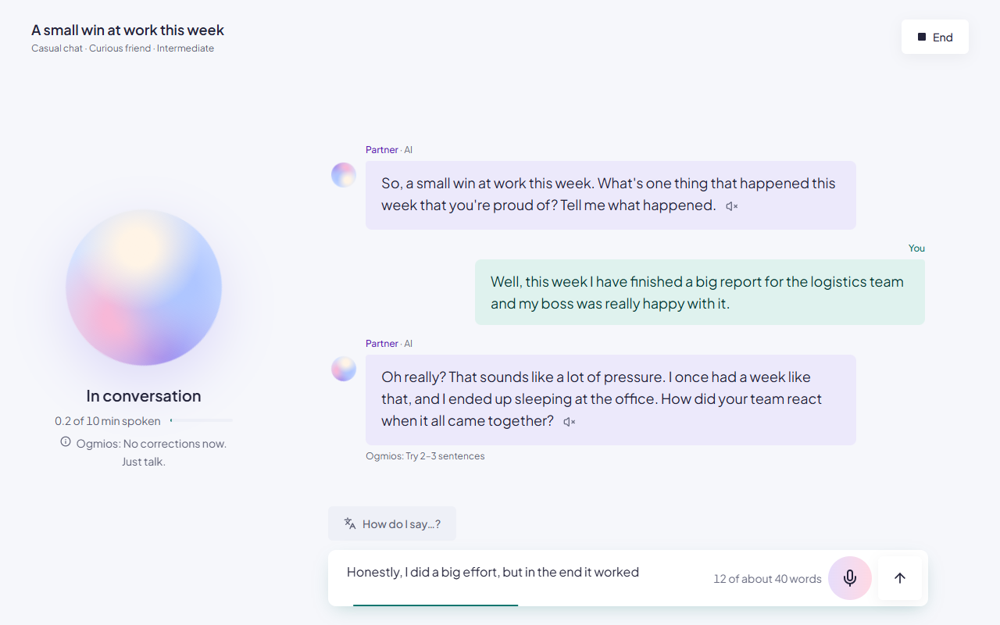
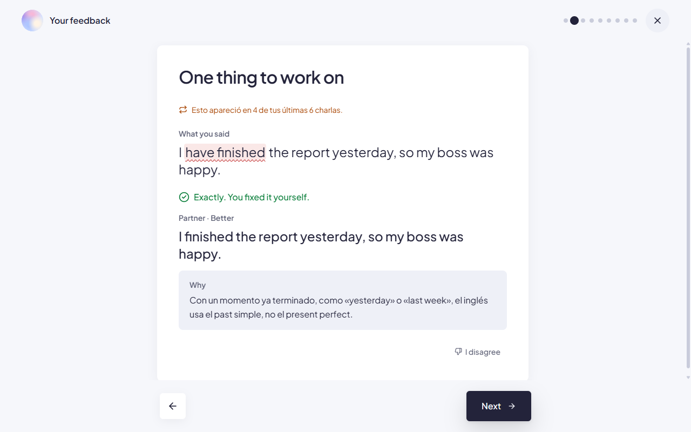

<p align="center">
  <picture>
    <source media="(prefers-color-scheme: dark)" srcset="assets/hero-dark.svg">
    
  </picture>
</p>

<p align="center">
  <a href="https://github.com/ilien-dev/ogmios/releases/latest"></a>
  <a href="https://github.com/ilien-dev/ogmios/releases/latest"></a>
  <a href="https://github.com/ilien-dev/ogmios/actions/workflows/ci.yml"></a>
  <a href="LICENSE"></a>
  <a href="https://ogmios.ilien.dev"></a>
</p>

# Ogmios: practice English speaking with AI (Claude)

**English** | [Español](README.es.md)

Ogmios is a free, open-source desktop app for macOS and Windows to practice
spoken English with Claude, Anthropic's AI. You talk or type, nobody corrects
you mid-sentence, and when you finish you get one thing to focus on. It also
teaches you the vocabulary of your own books before you read them.



**[Download for Windows](https://github.com/ilien-dev/ogmios/releases/latest)** ·
**[Install on macOS](#install)** ·
**[See it running on the website](https://ogmios.ilien.dev)**

Ogmios is free. The AI is not included: you connect your own Claude, with an
Anthropic API key or with Claude Code. [More on that below](#what-you-need).

## What it does

### English conversation practice

You pick a topic and a level, from basic to advanced, and talk. You can hold
the microphone and speak, or type. Your partner asks, listens and follows what
you say.

- **No corrections while you talk.** The partner never stops you to fix a
  mistake. If you get stuck, "How do I say…?" gives you a few ways to say
  something in English from your own language.
- **Feedback after the conversation.** You get what went well, one thing to
  work on and at most two smaller points, explained in your native language.
  For grammar, you see your own sentence and try to fix it before the answer
  shows.
- **An error memory.** A mistake you repeat becomes a pattern that moves
  through detected → in focus → improving → mastered. Your partner steers the
  next conversations towards the one in focus. A pattern counts as mastered
  only when you get it right in real conversations, not just in drills.
- **Short drills when you want them.** Two minutes, mixing the structure you
  are working on with the others.
- **Speech-to-text on your computer.** Your voice is turned into text on your
  machine, and you can edit the text before you send it.



### Vocabulary from your own books

Add a book in English as an EPUB or a PDF. Ogmios prepares it chapter by
chapter.

- **See how ready you are for each chapter.** A chart shows which chapters you
  can read now and which still have words to learn.
- **Learn the words with the book's own sentences.** Each word is asked with a
  sentence from the book, into your language and back into English. Words you
  already know can be marked and left out.
- **Daily review with spaced repetition.** A learned word comes back after 1,
  3, 7, 21 and 60 days. Your conversation partner also uses the words you are
  about to forget.
- **More ways into the same chapter.** Translate it sentence by sentence,
  practice its sentence structures, or train your ear with dictations.


## What you need

Ogmios works with Claude and does not run without it. You need one of these:

1. **An Anthropic API key** (recommended). It is stored in your system's
   keychain, and you pay Anthropic for what you use. A 20-minute conversation
   costs roughly $0.20 with Sonnet 5. That is an estimate, not a measurement.
2. **Your own Claude Code.** Ogmios runs the `claude` you installed and logged
   into yourself. It never sees your credentials. Anthropic may limit
   subscription use in third-party apps, so this way can stop working at any
   time.

Ogmios is an independent project. It is not affiliated with or endorsed by
Anthropic.

## Install

**Windows**: download `Ogmios_x64-setup.exe` from the
[latest release](https://github.com/ilien-dev/ogmios/releases/latest) and run
it. The installer is not signed yet, so SmartScreen warns about it: choose
**More info → Run anyway**.

**macOS** (Apple Silicon), with Homebrew:

```sh
brew tap ilien-dev/ogmios https://github.com/ilien-dev/ogmios
brew install --cask ogmios
```

After that Ogmios updates itself: it checks for a new release at start-up, and
**Settings → About Ogmios** shows the version and installs the update.

There is no mobile app and no web version.

## Your data

Conversations, recordings, books and progress stay in a SQLite file on your
computer. Speech recognition runs locally and the audio never leaves your
machine. What is sent to Claude is the text of your conversations and, when
you prepare a chapter, the text of that chapter. There is no Ogmios account.

## Questions

**Is it free?** The app is, and its code is open under AGPL-3.0. You pay
Anthropic for your own use of Claude.

**How is it different from practicing English with ChatGPT or Claude
directly?** In a chat you write the prompt, ask for corrections and keep track
of your own mistakes. Ogmios has the conversation set up, holds every
correction until the end, remembers the mistakes you repeat and brings them
back in later conversations.

**What level of English do I need?** Any. You choose basic, intermediate or
advanced for each conversation.

**Which languages?** Ogmios teaches English. The interface is in English and
Spanish, and explanations are written in the native language you choose.

## Development

Requirements: [Bun](https://bun.sh) 1.3+, Rust stable, and the
[Tauri prerequisites](https://v2.tauri.app/start/prerequisites/) for your
platform (on Linux, also `libasound2-dev`).

```bash
bun install
bun run hooks:install   # formatting check before each commit
bun run tauri:dev       # the desktop app
bun run dev             # the interface alone, on a fake backend
bun run check           # types, lint, format, tests (TypeScript and Rust)
```

The speech recogniser for Linux x86_64 is in
`src-tauri/vendor/parakeet/`. For another platform, run
`scripts/build-parakeet.sh` (needs CMake, Ninja and a C++ compiler).

Layout: `src/` is the React interface, `src-tauri/` the Rust backend (data,
error memory, speech), `sidecar/` the process that talks to Claude, `shared/`
the types they exchange. The product spec is in `docs/SPEC.md`.

The website ([ogmios.ilien.dev](https://ogmios.ilien.dev)) is its own
repository, [ogmios-site](https://github.com/ilien-dev/ogmios-site), included
here as the `site/` submodule. Its windows play the real interface, so after a
change to the interface the demo is built again:

```bash
bun run site:install    # once: fetch the submodule and its packages
bun run site:demo       # rebuild the demo from this checkout
bun run site:dev        # the site, on http://localhost:4321
```

Commit inside `site/` and push it, then commit the new `site` pointer here.

## Licence

AGPL-3.0-only. See `LICENSE`. The speech recogniser (parakeet.cpp, ggml) is
MIT; the Parakeet models are CC-BY-4.0 by NVIDIA.
